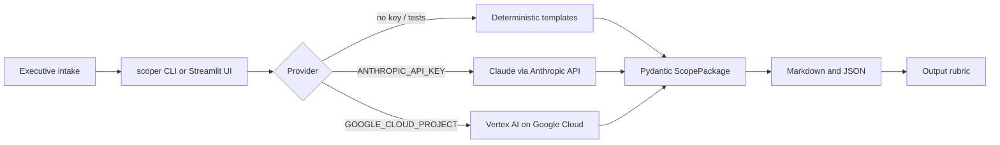

# Architecture Mission Scoper

Turn a vague "we want AI" request into a scoped four-week statement of work, a pilot plan, a STRIDE threat model, a mermaid architecture diagram, and success metrics.

The tool is meant for the start of an AI engagement: take messy intake, name a first shippable slice, and put a measurable success bar on it. It is not a production scoping service and it is not authority to operate.

## Features

- **Four-week SOW** — users, constraints, weekly goals and deliverables, and explicit out-of-scope items
- **Pilot plan** — baseline, success measures, first shippable slice, and first users
- **STRIDE threat model** — all six categories, with a threat and a mitigation for each
- **Architecture diagram** — mermaid flowchart plus a short caption
- **Success metrics** — baseline, target, and how each metric is measured
- **Structured output** — Pydantic-validated JSON, then rendered to Markdown
- **Offline template mode** — deterministic, no API key, used by default in tests
- **Optional cloud providers** — Claude via the Anthropic API, or Vertex AI on Google Cloud
- **Optional Streamlit UI**
- **Output rubric** — checks required sections, mermaid, and flags classification-like banners or SSN/card-like patterns

## Architecture



Cloud providers must return JSON that matches the `ScopePackage` schema. Template mode never calls a network and is the default when no credentials are set, so the demo and the test suite run offline.

## Quick start

Requires Python 3.11 or later.

```bash
python -m venv .venv
source .venv/bin/activate
pip install -e ".[dev]"

# Offline, no API key required
scoper generate --provider template \
  --input examples/northbridge-ops-request.md \
  --out out/

# Optional rubric check
scoper check out/scope-package.md
```

Outputs are `out/scope-package.md` and `out/scope-package.json`.

### Optional: Claude via the Anthropic API

```bash
pip install -e ".[anthropic]"
cp .env.example .env
# put ANTHROPIC_API_KEY in .env — never commit it
scoper generate --provider anthropic \
  --input examples/northbridge-ops-request.md \
  --out out/
```

### Optional: Vertex AI on Google Cloud

```bash
pip install -e ".[vertex]"
# Application Default Credentials, plus:
export GOOGLE_CLOUD_PROJECT=your-project-id
export GOOGLE_CLOUD_LOCATION=us-central1
scoper generate --provider vertex \
  --input examples/northbridge-ops-request.md \
  --out out/
```

`--provider auto` (the default) uses Anthropic if `ANTHROPIC_API_KEY` is set, otherwise Vertex if `GOOGLE_CLOUD_PROJECT` is set, otherwise template mode.

### Optional Streamlit UI

```bash
pip install -e ".[ui]"
scoper ui --provider template
```

## Pilot plan

Every generated package includes a pilot plan with four fields:

- **Baseline** — how the work is done today
- **Success measures** — what would make the four-week slice a success
- **First shippable slice** — the smallest useful system to put in front of users
- **First users** — who tries that slice

The same four fields describe this tool itself:

- **Baseline:** A vague "we want AI" request is scoped by hand. The write-up often misses a threat model, success metrics, or a first shippable slice.
- **Success measures:** Every generated package includes a four-week SOW, the four pilot-plan fields, all six STRIDE categories, a mermaid flowchart, and at least three success metrics. The rubric and unit tests pass offline, with the LLM mocked or replaced by templates. Cloud keys never appear in the repository.
- **First shippable slice:** A CLI (plus optional Streamlit), Pydantic models, deterministic templates, two fictional example intakes, and CI.
- **First users:** A project lead writing a pilot proposal, and a security reviewer reading the threat model and constraints.

## Example

All intake in the examples is fictional and unclassified. Do not paste real documents.

1. Open `examples/northbridge-ops-request.md`. It is a rambling request from a fictional company, Northbridge Logistics, for an operations-brief assistant that must respect role-based access, keep working when a site WAN link is down, and require a human approval before sharing a packet with an external partner.
2. Run `scoper generate --provider template --input examples/northbridge-ops-request.md --out out/`.
3. Walk through `out/scope-package.md`: the four-week SOW, the pilot plan, the STRIDE model, the mermaid diagram (private VPC, no public egress), and the metrics.
4. Optionally rerun the same file with `--provider anthropic` or `--provider vertex` if credentials are configured, and compare structure (not wording) against the template output.
5. Repeat with `examples/harborline-erp-request.md` to see the same tool on a systems-of-record request from a second fictional company, Harborline Retail.

A short walkthrough is steps 1–3 only. Checked-in sample output lives beside each request file.

## Tests

```bash
pytest -q
ruff check src tests
```

Tests mock cloud providers and run the template path offline. GitHub Actions runs lint and tests on each push and pull request to `main`.

## Security and license

See [SECURITY.md](SECURITY.md): fictional, unclassified data only; no real personal data, no restricted documents, no keys in git. Released under the MIT License — see [LICENSE](LICENSE).
