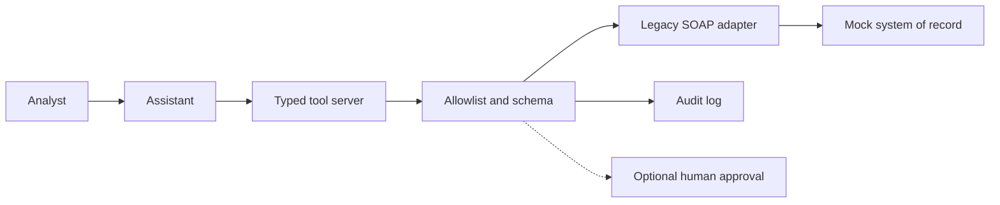

# Legacy system-of-record assistant — four-week pilot

## Customer problem

Analysts swivel-chair between a chat assistant and a thick-client ERP or ticket system. Any automation today would mean a shared password and unlogged writes. The intake asks for a scoped four-week pilot that can read — and carefully write — a legacy system of record through a typed tool interface.

## Four-week statement of work

Give an assistant a safe, allowlisted interface to a fictional legacy SOAP/RPC system so users can look up records and propose updates without a raw pipe to destructive methods.

### Users

- Operations analyst (lookups and proposed updates)
- Approver (commits to the system of record)
- IT administrator (allowlist and audit review)

### Constraints

- Fictional records only; no production ERP connectivity
- Writes are dry-run by default
- Deny-by-default for methods not on the allowlist
- Every tool call is audited

### Week 1

Goals:

- Stand up a mock SOAP service and a typed tool contract

Deliverables:

- Mock schema and fixture records
- Read-only lookup tools

### Week 2

Goals:

- Add a two-phase write path (propose, then commit)

Deliverables:

- Dry-run diffs
- Explicit commit flag

### Week 3

Goals:

- Enforce the allowlist and wire an optional human approval on commit

Deliverables:

- Deny-by-default policy tests
- Approval hook

### Week 4

Goals:

- Package a client config, audit viewer, and pilot readout

Deliverables:

- Documented tool-client config
- Audit sample
- Pilot metrics

### Out of scope

- A real SAP, Oracle, or other vendor connection
- Bulk data migration
- Replacing the legacy client for all users

## Pilot plan

### Baseline

Lookups and updates happen in a thick client. Informal copy-paste into a chat tool is unlogged. There is no allowlist or dry-run for automated writes.

### Success measures

- 100% of non-allowlisted methods are denied in contract tests
- Every write produces a dry-run diff and an audit record before commit
- Commit cannot proceed without an explicit confirmation (and an approval id when enabled)

### First shippable slice

Read tools plus a two-phase write against a mock SOAP service, with deny-by-default and a published client config.

### First users

- One fictional operations analyst
- One fictional approver
- One fictional IT administrator

## STRIDE threat model

The pilot must not become an unauthenticated, unlogged back door into a system of record, even when that system is a mock.

### Spoofing

- Threat: A caller invokes tools without a user or task identity.
- Mitigation: Require a user-bound credential on every tool call; reject anonymous traffic.

### Tampering

- Threat: A proposed update is altered between dry-run and commit.
- Mitigation: Bind commit to the dry-run hash and expire stale proposals.

### Repudiation

- Threat: A record changes and no one can show which tool call did it.
- Mitigation: Append-only audit with tool name, actor, payload, and result.

### Information disclosure

- Threat: The model echoes fields a given user should not see.
- Mitigation: Filter tool results by role and keep raw SOAP out of logs by default.

### Denial of service

- Threat: A looping agent floods the legacy mock or the real interface later.
- Mitigation: Rate limits, timeouts, and idempotency keys on writes.

### Elevation of privilege

- Threat: The agent calls a delete or admin method that was never granted.
- Mitigation: Deny-by-default allowlist and contract tests for disallowed methods.

## Architecture

The assistant never talks to the legacy API directly. A typed tool layer applies allowlist, schema, dry-run, and audit policy first.

## Success metrics

| Metric | Baseline | Target | How measured |
| --- | --- | --- | --- |
| Allowlist enforcement | No method-level policy | 100% of disallowed methods denied | Contract test suite against the mock service |
| Write safety | Unlogged direct edits in a thick client | Every write has a dry-run diff and an audit record | Audit log review of the demo script |
| Time to look up a record | Swivel-chair between chat and thick client | Lookup completed in one assistant turn on fixture records | Timed walkthrough on the sample data |
