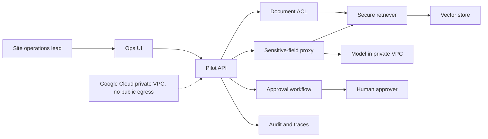

# Role-restricted operations assistant — four-week pilot

## Customer problem

Operators assemble site briefs by hand from shared drives and chat threads. The same question can surface material a given role should not see, and the assistant is simply unavailable when a site network link is down. The intake asks for a scoped four-week pilot, not a company-wide rollout. This package uses only fictional, unclassified assumptions about Northbridge Logistics.

## Four-week statement of work

Stand up a pilot assistant that drafts operations briefs for a fictional logistics company, respects role-based access, keeps sensitive fields out of the model context, and continues to run inside a private network when public egress is blocked.

### Users

- Site operations lead (drafts and reviews briefs)
- Finance analyst (different document set)
- Approver (human-in-the-loop for outbound partner shares)

### Constraints

- Fictional, unclassified company data only
- Document-level access control at retrieval time
- No public internet egress from the pilot VPC
- High-stakes actions (share with a partner, or open a ticket) require a recorded human approval

### Week 1

Goals:

- Lock the data model, roles, and fixture corpus
- Stand up retrieval with document ACLs

Deliverables:

- Role matrix
- Unclassified fixture set
- ACL-filtered retrieval spike

### Week 2

Goals:

- Add a deterministic sensitive-field proxy
- Wire a first brief-drafting prompt

Deliverables:

- Tokenize-and-restore path with an audit log
- Draft-brief API

### Week 3

Goals:

- Pause high-stakes tool calls for human approval
- Prove the workflow survives a restart

Deliverables:

- Approval inbox for share/ticket actions
- Crash-recovery demo script

### Week 4

Goals:

- Deploy into a private VPC with no public egress
- Measure the pilot against the success metrics

Deliverables:

- Terraform/Helm private-VPC deploy
- Egress smoke test
- Pilot readout

### Out of scope

- Live production data or real customer records
- Company-wide rollout beyond the first operations-center cohort
- Production identity federation (stub identity is enough for the pilot)

## Pilot plan

### Baseline

Briefs are assembled manually from shared drives. Role-based access is informal. There is no assistant when a site link is down, and outbound partner shares have no recorded approval.

### Success measures

- Zero unauthorized document hits on the fixture ACL tests
- All planted sensitive spans are tokenized before inference
- An in-flight approval still waits after a worker restart
- Egress smoke test shows no public internet path from the pilot VPC

### First shippable slice

ACL-filtered retrieval, a sensitive-field proxy, one approval-gated action, and a private-VPC deploy on the fictional fixture set.

### First users

- Two fictional site operations leads
- One fictional finance analyst
- One fictional approver

## STRIDE threat model

The pilot's main risks are identity confusion, prompt or corpus tampering, unlogged shares, leakage across role boundaries, a hard dependency on a single model endpoint, and an agent expanding its own privileges.

### Spoofing

- Threat: A user or agent presents itself as a more privileged role and retrieves the wrong corpus.
- Mitigation: Authenticate at the edge, bind every request to a role, and enforce ACLs in the retriever, not the prompt.

### Tampering

- Threat: Fixture documents or prompts are modified to exfiltrate another role's context.
- Mitigation: Version and hash the corpus, restrict who can edit prompts, and review retrieval traces.

### Repudiation

- Threat: A share or ticket is issued and later denied because there is no durable record.
- Mitigation: Immutable audit log plus a workflow history for every high-stakes action.

### Information disclosure

- Threat: Sensitive spans or unauthorized documents reach the model or another user.
- Mitigation: Document-level access control, pre-inference tokenization, and no public egress from the VPC.

### Denial of service

- Threat: The assistant becomes unusable if a cloud endpoint is unreachable — the original customer complaint.
- Mitigation: Keep inference and stores inside the private VPC; fail closed on egress; test a blocked-internet path.

### Elevation of privilege

- Threat: The agent calls a write or share tool it was not granted, or expands its own scopes.
- Mitigation: Short-lived task-bound credentials, allowlisted tools, and a human approval gate on restricted actions.

## Architecture

Pilot request path inside a Google Cloud private VPC: authorize, tokenize, retrieve only authorized chunks, infer with no public egress, and pause restricted actions for a human.

## Success metrics

| Metric | Baseline | Target | How measured |
| --- | --- | --- | --- |
| Unauthorized retrieval rate | Not measured; shared-drive access is informal | 0 hits on the fixture ACL suite | Automated retrieval tests per role |
| Sensitive-span handling | Raw fields can be pasted into a chat tool | 100% of planted spans tokenized before infer | Proxy audit log vs. planted fixture values |
| Approval durability | No recorded approval for outbound partner shares | In-flight approvals resume after a forced worker restart | Chaos step in the demo script |
| Egress posture | Tools assume public internet | No public egress from the pilot VPC | Automated egress smoke test |
